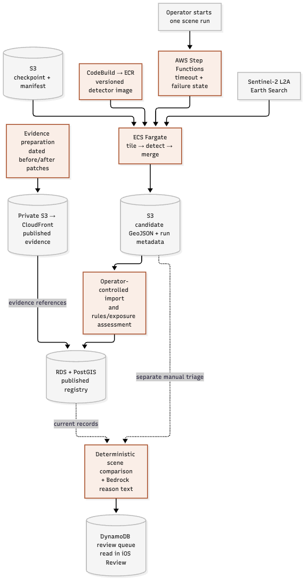
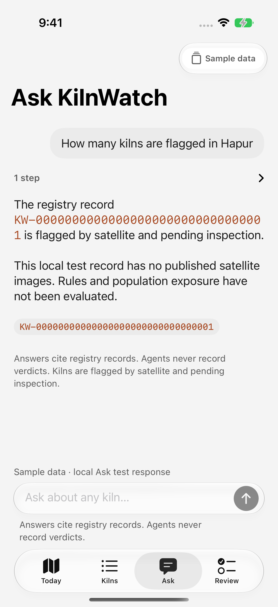
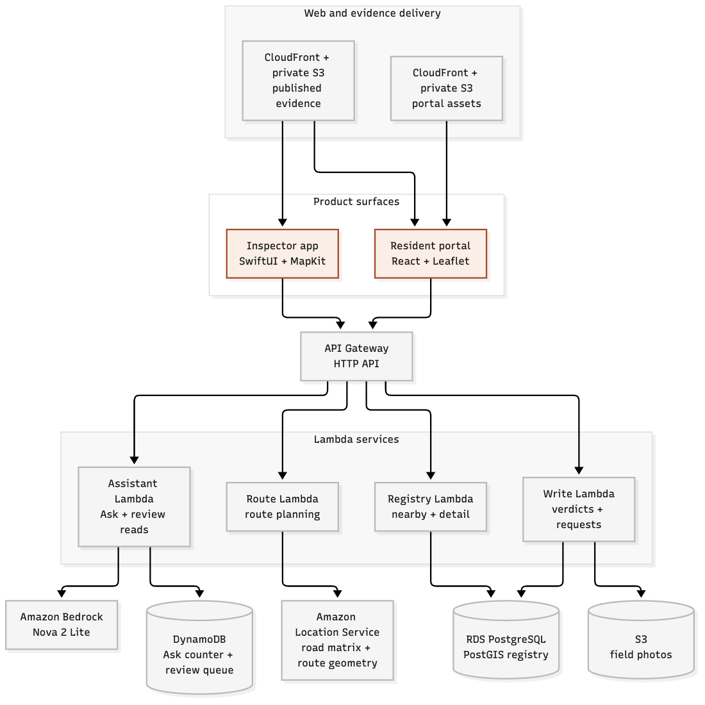

## Every winter, Delhi disappears

The sky goes grey. The skyline goes soft. Stubble fires and traffic take the headlines.

But some of that haze comes from places most people never see: thousands of brick kilns scattered across the farmland around the city. They burn all season, mostly out of sight.

The numbers are not small. IIT Gandhinagar’s [Space to Policy research](https://arxiv.org/abs/2412.04065) reports that the brick-kiln sector contributes **8–14% of air pollution in India**. Its [research project](https://sustainability-lab.github.io/brick-kilns/) reports **70% of studied kilns triggering at least one compliance check**. These are findings from the research, separate from our Hapur prototype.

The rules exist. The inspectors exist. What's missing is a map. Nobody knows where every kiln is, or which one to visit first.

So we built **KilnWatch**. It reads Sentinel-2 imagery, identifies candidate kilns, measures cited siting signals, and hands an inspector a route for the morning.

The whole system runs on one sentence:

> **The model finds. Code checks. Agents plan. People decide.**

Our goal is to turn IIT Gandhinagar’s research into a **closed-loop application**: detection, evidence, prioritisation, field inspection and a recorded human outcome. The research supplies the foundation; KilnWatch connects it to the people who can act.

Each part of that sentence is a boundary. This post walks through all four, and spends most of its time on the third.

*An existing live-backend capture of the Hapur portal. Pins are candidate records; publication does not establish compliance.*

## 1. The model finds

From space, a kiln is a few pixels wide. At Sentinel-2's 10 metres per pixel, you need a model that has seen a lot of them.

We trained **YOLO11 with oriented bounding boxes** on [**SentinelKilnDB**](https://openreview.net/pdf?id=efGzsxVSEC), the NeurIPS 2025 dataset from IIT Gandhinagar’s Sustainability Lab and an IIIT Surat collaborator. The [benchmark repository](https://github.com/rishabh-mondal/SENTINELKILNDB_NeurIPS_2025) lists **114,300 image tiles and 97,648 box annotations**; the [research project](https://sustainability-lab.github.io/sentinelkilndb/) reports **62,671 unique kilns**. Box annotations and unique sites are different counts.

Why oriented boxes? Kilns sit at every angle. A normal box around a tilted kiln grabs empty field too. And the footprint matters, because every distance in the next step is measured from it.

The [saved baseline results](https://github.com/aryamanraj2/KilnWatch/blob/main/Model/results/baseline_scores.json) report **0.86 any-kiln AP50** on the full test protocol. That metric groups kiln types together; the three-class mAP50 is **0.685** on the full test and **0.379** on the strict test. These supplied scores are not independently measured Hapur accuracy, and their linkage to the deployed checkpoint is not established in the [checkpoint manifest](https://github.com/aryamanraj2/KilnWatch/blob/main/Model/results/checkpoint-manifest.json). On the October 2026 Hapur scene, the recorded AWS run returned **39 candidates**.

On AWS, detection is a one-shot pipeline. **AWS CodeBuild** builds the detector image and pushes it to **Amazon ECR**. **AWS Step Functions** starts an **Amazon ECS task on AWS Fargate**. The task pulls the weights from **Amazon S3**, verifies their hash, and reads Sentinel-2 straight from the [**Registry of Open Data on AWS**](https://registry.opendata.aws/sentinel-2-l2a-cogs/). The task reads the imagery it needs; outputs and evidence are stored separately. Import into the registry is a controlled operator step.

The [recorded Hapur run](https://github.com/aryamanraj2/KilnWatch/blob/main/AWS/docs/local-verification.md#m0-detector-on-aws-38--live-2026-10-11) took **78 seconds end to end**, including **12.9 seconds of detection over 120 patches**. That is one measured run, not a universal runtime or an all-in cost estimate.

*Operator-triggered inference. Registry import, evidence publication and change-triage invocation are controlled steps.*

## 2. Code checks

A detection is a shape on a map. An inspector can't act on a shape. They need to know what it's near and who lives around it.

The detections land in **Amazon RDS for PostgreSQL with PostGIS**, in private subnets. A rules engine measures every kiln footprint against **cited siting rules**: distance to homes, to other kilns, to highways, to railways. Meta and CIESIN’s [**High Resolution Settlement Layer**](https://registry.opendata.aws/dataforgood-fb-hrsl/), also on AWS Open Data, counts the people living within 800 metres.

What comes out is a fact, not a judgement:

> *Measured distance from homes · cited threshold · estimated population within 800 m*

Those fields come from geometry, a versioned rulebook and population data. No model touched it. This is the most important design choice in the system: **distances and the law live in code and data, never in a language model.**

*Live-backend evidence capture. These are dated satellite snapshots, not a live camera feed.*

Which brings us to the language models.

## 3. Agents plan

Language models are good at planning, summarising and explaining. They are not a source of truth about distances or the law. So KilnWatch gives agents only the jobs where language helps, and fences them in hard.

The three product roles use [**Amazon Bedrock with Amazon Nova 2 Lite**](https://docs.aws.amazon.com/nova/latest/userguide/what-is-nova.html), through the [Converse API with tool use](https://docs.aws.amazon.com/bedrock/latest/userguide/tool-use.html), inside **AWS Lambda**. The inspector and resident assistants share a serving runtime; change triage is a separate internal workflow.

### Agent 1: The inspection planner

An inspector opens the iOS app and types what they'd say to a colleague:

> *"Plan a route from 28.7306, 77.7759 with 4 stops."* *"Which Hapur kilns have the most people within 800 m?"* *"Give me the inspection sheet for this kiln."*

The agent answers by reasoning over **six read-only tools**:

| Tool | What it returns |
| --- | --- |
| `list_flagged_kilns` | The registry's flagged kilns |
| `kilns_near` | Kilns near a point |
| `kiln_detail` | Rules, distances and exposure for one kiln |
| `get_evidence` | Satellite image dates, scene and attribution |
| `plan_route` | A drive-time route via **Amazon Location Service** |
| `inspection_sheet` | A one-page brief per stop: rules flagged, people exposed, what to check on site |

The inspector watches the agent work. The interface shows the tools used: *"Searching flagged kilns · 38 found."* Then a plain answer, where every kiln is a tappable citation.

The route isn't guessed by the model. A small nearest-neighbour plus 2-opt solver orders the stops over the Amazon Location drive-time matrix. Each stop hands off to Apple Maps.

*Local UI-polish capture with mocked Ask data. It illustrates the interface; the live portal Ask capture below shows a backend answer.*

### Agent 2: The change triage agent

Satellites come back every few days. Kilns get built, abandoned, converted. Someone has to notice.

The triage agent compares an older detector run from **December 2023** with today's registry from **October 2026**. Here's the trick: **the agent doesn't do the matching.** Deterministic code pairs kilns by footprint overlap, with a distance fallback, and sorts every difference into one of four groups:

| Group | Meaning |
| --- | --- |
| Not detected in Dec 2023 | In today's registry, no 2023 match |
| No longer detected | Present in 2023, missing in 2026 |
| Possible zigzag conversion | May have moved to the cleaner kiln technology |
| Low detector score | Detection score below 0.5 |

The model gets one job: write a one or two sentence reason for each item, from that item's facts alone. A validator then rejects any reason that invents a kiln ID, says a kiln was "built" or "demolished", or uses a status word.

Each surviving item lands in an **Amazon DynamoDB** review queue as a **candidate pending human review**. Hapur's first run queued **45 candidates**. Inspectors see them read-only in the app's Review tab.

**The agent can't change a single kiln's status.**

*Live-backend Review capture. The queue records detector differences for human review, not established construction or closure events.*

### Agent 3: The resident assistant

The people breathing this air deserve the same facts as the inspector.

On a public website, in **English or Hindi, with no login**, a resident can find the kilns near home, see before-and-after satellite evidence, and ask questions in plain language. The assistant explains each rule simply and cites the record behind every claim.

*Live Ask capture. Population estimates describe nearby residents, not measured pollution exposure or health outcomes.*

Then they can act. One tap on **"Request an inspection"** records an anonymous request. Every neighbour who asks adds to a count the inspector sees in the app.

*Local UI-polish capture of the Hindi form. A request is an anonymous signal for an inspector, not a verdict.*

The assistant is honest about what that count is. It's a signal, not verified evidence, and it never changes a kiln's status.

## Why the agents never decide

This is the part we're proudest of. There are four layers intended to reduce unsupported answers and unauthorised actions. They have different jobs; they do not make the system error-proof.

**Read-only tools.** No agent tool can change a kiln's status or record a verdict. The only write any agent has is adding a candidate to the review queue.

**A citation validator.** Before any answer reaches a screen, deterministic code checks it. Every kiln ID and rule ID must come from *this request's* tool results. Banned words like "illegal" are rejected. A failed answer gets one regeneration. If that fails too, the user sees a safe fallback.

**Cost caps that fail closed.** Daily caps in DynamoDB limit Ask, routing, verdicts and requests. If the counter can't be read, the request is refused. It is never waved through.

**Honest language, everywhere.** Until an inspector visits, every kiln reads *"Flagged by satellite · pending inspection."* Rule hits are called siting signals. A model score is never called accuracy. Missing data is never shown as zero.

### Then people decide

On site, the inspector records a verdict with a geotagged photo. It saves offline and syncs when there's signal. Photos go to S3 through presigned uploads.

An accepted inspector verdict updates the registry status. Human field verification is the intended workflow; this public demo does not yet authenticate inspectors or prove that a submission came from the site.

## The full AWS picture

The deployment is in **Mumbai**, with its core infrastructure defined in Terraform.

| Layer | Services |
| --- | --- |
| Detection pipeline | CodeBuild, ECR, Step Functions, ECS on Fargate, S3, Open Data on AWS |
| Registry and rules | RDS for PostgreSQL + PostGIS, VPC, Secrets Manager, EC2 + Systems Manager |
| APIs | Lambda, API Gateway (HTTP API), throttled and capped |
| Agents | Amazon Bedrock (Amazon Nova 2 Lite), Amazon Location Service, DynamoDB |
| Delivery | Amazon CloudFront with Origin Access Control over private S3 |
| Operations | CloudWatch, SNS, AWS Budgets, IAM least privilege |

*The serving architecture. Tool calls fetch typed facts through backend APIs; the language model has no direct database connection. [Full architecture and implementation evidence](https://github.com/aryamanraj2/KilnWatch#aws-architecture).*

## Five things we learned building agents

**Fix the data shape, not the prompt.** The model kept misreading a table of true/false columns. More prompt lines didn't help. Giving it explicit, per-item facts did.

**Contradictions get resolved at random.** If two prompt lines disagree, the model will follow one of them. Delete one. Don't add a third to referee.

**Let code do the counting.** In triage, the groups and numbers are deterministic. The model only writes the reason, behind a validator. Answers got cheaper and more trustworthy at the same time.

**Validators beat vibes.** A 50-line deterministic check catches more bad answers than any amount of "please be accurate".

**Fail closed.** For anything that costs money or faces the public, the safe default is no.

## What's next

Today KilnWatch covers **39 kilns in Hapur**. That's one district. The NCR has many more.

Three things come next. Inspector verdicts become training labels for the next model, with a separate validation process before those labels are used to improve the detector. Triage runs automatically after every satellite pass. And the pipeline expands district by district across the NCR.

None of it is specific to Delhi. Sentinel-2 makes geographic expansion possible; each new district still needs suitable imagery, reference mapping, applicable rules and local validation.

> **The model finds. Code checks. Agents plan. People decide.**

---

*Built with [SentinelKilnDB](https://sustainability-lab.github.io/sentinelkilndb/), [Copernicus Sentinel-2 data](https://registry.opendata.aws/sentinel-2-l2a-cogs/), [Meta and CIESIN’s High Resolution Settlement Layer](https://registry.opendata.aws/dataforgood-fb-hrsl/), and [OpenStreetMap](https://www.openstreetmap.org/copyright).*

**Explore KilnWatch:** [GitHub repository](https://github.com/aryamanraj2/KilnWatch) · [Three-minute demo walkthrough](https://github.com/aryamanraj2/KilnWatch#a-three-minute-demo) · [Portal interaction recording](https://github.com/aryamanraj2/KilnWatch/blob/main/Web/ResidentPortal/docs/screens/polish-45/portal-interaction.webm)

**Research:** [SentinelKilnDB paper](https://openreview.net/pdf?id=efGzsxVSEC) · [Space to Policy paper](https://arxiv.org/abs/2412.04065)
