

# KilnWatch

### From satellite evidence to a field inspection.

**Turning IIT Gandhinagar's brick-kiln detection research into a closed-loop application.**

**An inspector app. A resident portal. One shared kiln registry.**

Built for the **WeMakeDevs × AWS Bharat Builds Tour — Environmental Hacks**.

[Research foundation](#from-research-to-a-closed-loop-application) · [Product](#the-product) · [AWS architecture](#aws-architecture) · [Agents](#three-agent-roles-with-bounded-authority) · [Model](#the-model-and-what-its-results-mean) · [Evidence](#evidence-for-a-technical-review)

---

## From research to a closed-loop application

**KilnWatch's central goal is to turn research into a usable inspection workflow.** Its research foundation is [SentinelKilnDB (NeurIPS 2025 Datasets & Benchmarks)](https://openreview.net/pdf?id=efGzsxVSEC), developed by researchers at **IIT Gandhinagar's Sustainability Lab**, with a collaborator from **IIIT Surat**. The work provides a large, hand-validated brick-kiln dataset and detection benchmarks using freely available Sentinel-2 imagery. [Research project and authors](https://sustainability-lab.github.io/sentinelkilndb/).

We build on that foundation by connecting detection to evidence, measured siting checks, resident questions and requests, inspector routes, and a recorded field verdict—all through a shared AWS backend, native iOS app and web portal.

**Detect → examine evidence → prioritise → inspect → record the outcome → inform the next review.**

This is the operational loop KilnWatch aims to close. The prototype captures human outcomes in the registry; feeding those outcomes into model retraining remains future work. Our contribution is the application and its integration around the research. The model section separately identifies the supplied benchmark results and the checks performed on this implementation.

---

Brick-kiln monitoring needs a practical chain from **where to look** to **what to check** to **who records the outcome**. KilnWatch connects those steps: satellite detection identifies candidates; geospatial code measures siting signals and nearby population; inspectors receive routes and evidence; residents can request an inspection.

**The model detects. Code measures. Agents explain and plan. An inspector records the verdict.**

| Hapur pilot | Published evidence | Change review | Connected surfaces |
| :---: | :---: | :---: | :---: |
| **39 candidate records** | **39 before/after pairs** | **45 pending items** | **iOS + web** |

*Snapshot: 11 October 2026. The registry contains 38 flagged records and one inspector verdict recorded during the demo. These counts describe a pilot dataset, not detector accuracy or district-wide coverage.*

## The product

<table>
  <tr>
    <th align="center">Plan the visit</th>
    <th align="center">Inspect the evidence</th>
    <th align="center">Review changes</th>
  </tr>
  <tr>
    <td align="center">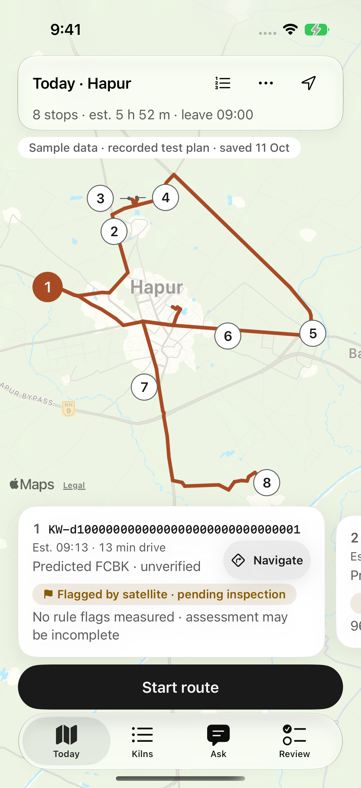</td>
    <td align="center">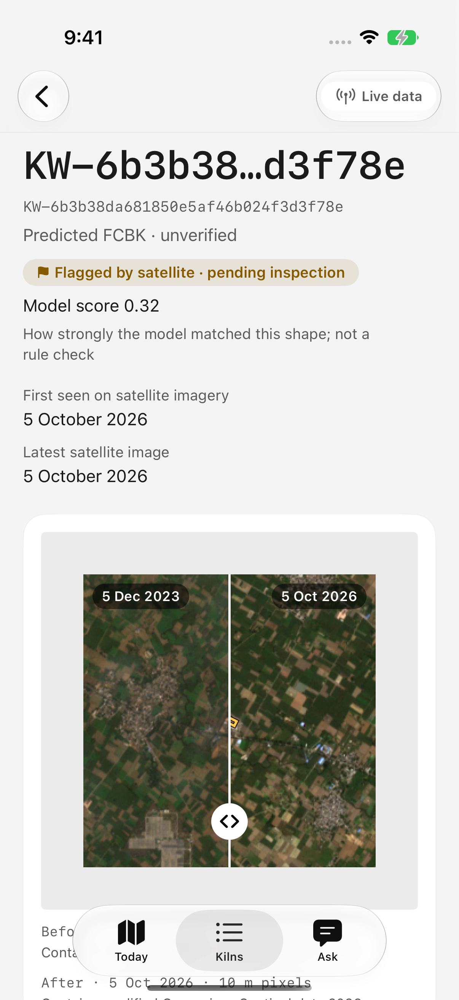</td>
    <td align="center">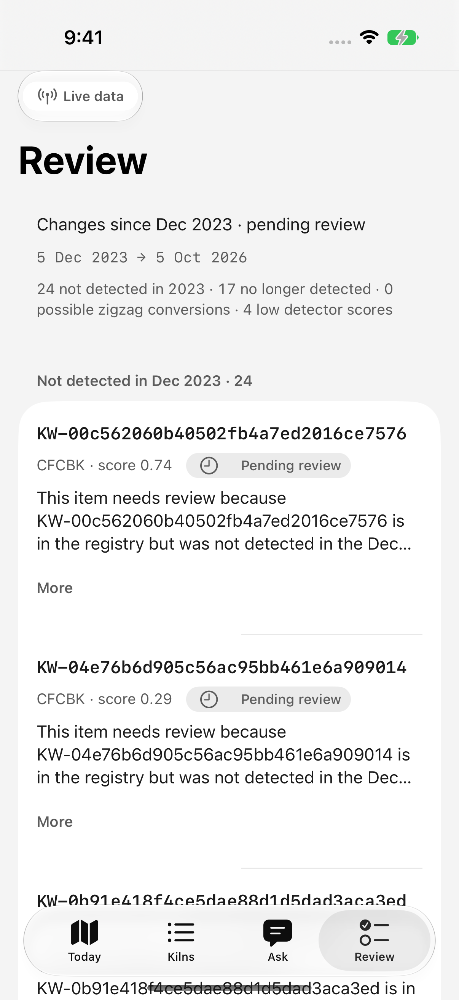</td>
  </tr>
  <tr>
    <td>Ordered stops, road geometry, estimated arrivals and navigation.</td>
    <td>Acquisition dates, predicted kiln type and satellite evidence.</td>
    <td>Stored reasons and scores, with access to current and historical locations.</td>
  </tr>
</table>

*Today is a local UI-polish capture using a recorded test plan. Evidence and Review are earlier live-backend captures. The imagery is real; the route preview is explicitly labelled sample. Screenshots document their capture state rather than promising current counts or identical deployed styling.*

### Inspector app

A native **SwiftUI + MapKit** app gives the inspector four workspaces:

| Workspace | What the inspector can do |
| --- | --- |
| **Today** | Plan a bounded route, inspect stop details, follow the road-order itinerary and hand off navigation to Apple Maps. |
| **Kilns** | Browse published records, compare imagery, examine measured rule checks and see modelled population and resident-request aggregates. |
| **Ask** | Ask a question, see the tools used, follow record citations and request a route or inspection sheet. |
| **Review** | Read pending satellite-change items, their reasons and historical locations. This tab has no approval action. |

Field verdicts support notes, photos and location metadata. A local outbox preserves a submission while offline and retries delivery; an unsent entry remains pending rather than appearing as a completed server verdict. Saved routes remain available for inspection work with poor connectivity.

### Resident portal

Residents explore the **same public records** on an interactive **React + Leaflet** street map. A confirmed coordinate-and-radius search returns nearby candidates; a selected pin opens the evidence, rule checks and inspection-request action. English and Hindi interface controls share the same visual language as the inspector app.

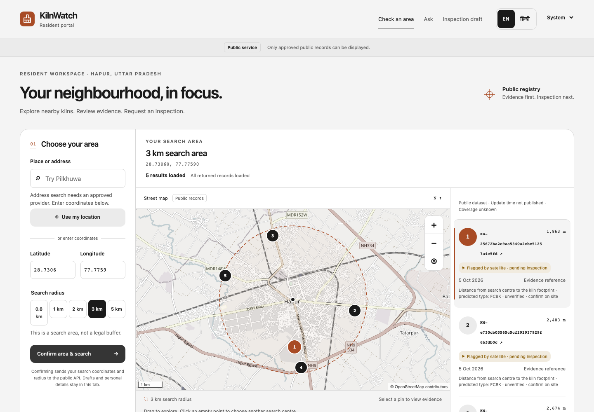

*Existing live capture: five records returned within a 3 km search. The search circle describes the resident's query, not a regulatory distance threshold. Earlier banner wording in this capture describes publication; it does not establish a site finding.*

The portal also provides **Ask**, which calls the shared backend assistant, and **Request an inspection**, which stores an anonymous signal and displays the updated count to residents and inspectors. A separate written-request draft can be edited and exported; preparing that document does not submit it to an authority.

<strong>See a backend-grounded Ask answer and the resident request form</strong>

 

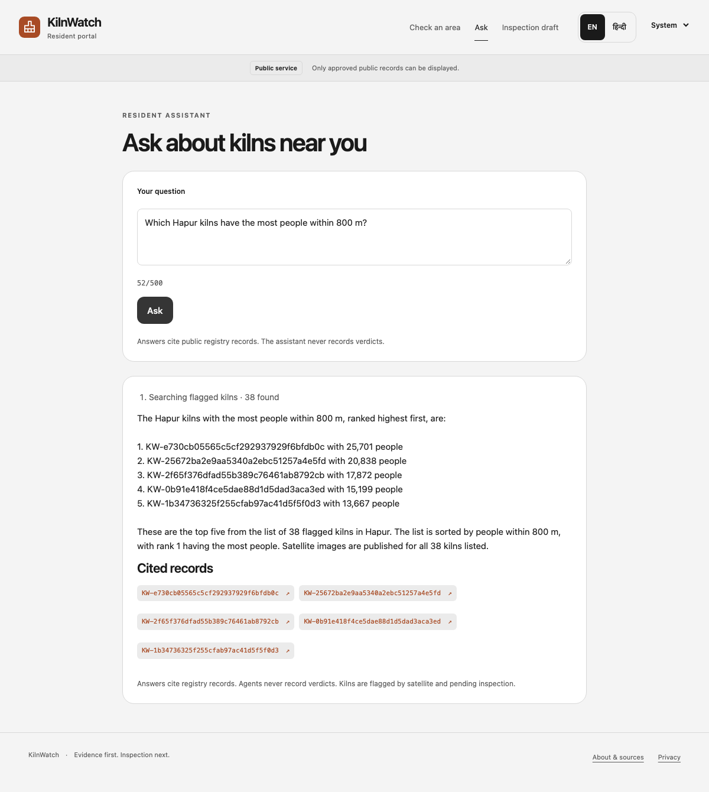

*Live Ask capture. The figures are modelled population estimates from the registry, not measured emissions or health outcomes.*

<table>
  <tr><th align="center">English request</th><th align="center">Hindi request</th></tr>
  <tr>
    <td align="center">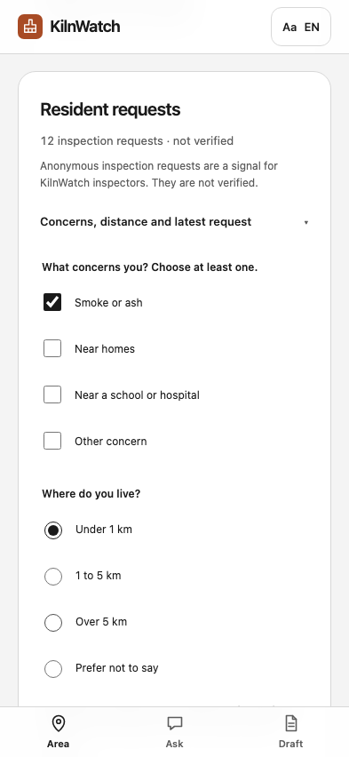</td>
    <td align="center">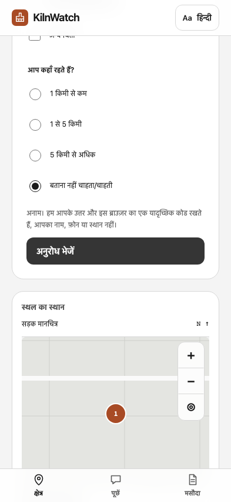</td>
  </tr>
</table>

*Request-form images are local UI previews with mocked records and counts. The request endpoint has separately passed live insert, duplicate and aggregate-read checks; the test request was then cleared.*

## How a satellite candidate becomes an inspection

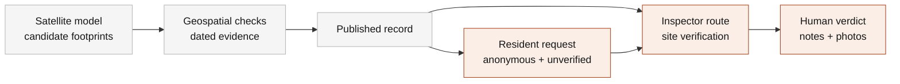

Resident requests are visible context for an inspector; they do **not** currently alter the route-ranking algorithm. A satellite flag, a model score or a request count never changes a record's status automatically.

## AWS architecture

### Serving the app and portal

The deployed clients share an **API Gateway HTTP API**. Lambda separates public registry reads, assistant/review access, road-route planning, and verdict/request writes. **RDS PostgreSQL + PostGIS** holds the registry and spatial data; **Amazon S3** holds evidence and field photos.

**Platform: clients, API routing and the private registry**

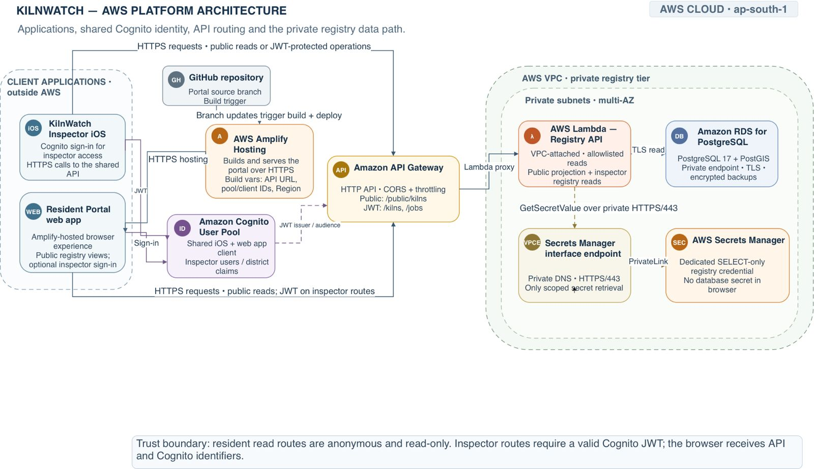

The initial plan was to host the resident web portal using AWS Amplify Hosting. However, we switched to Amazon CloudFront with a private S3 bucket as the origin for the final deployment. CloudFront provides edge caching for faster asset delivery and Origin Access Control (OAC), ensuring the S3 bucket remains private. This approach offers greater control over content delivery and access permissions, while the portal's APIs continue to run on Amazon API Gateway and AWS Lambda.

**Public resident services: Ask and route planning**

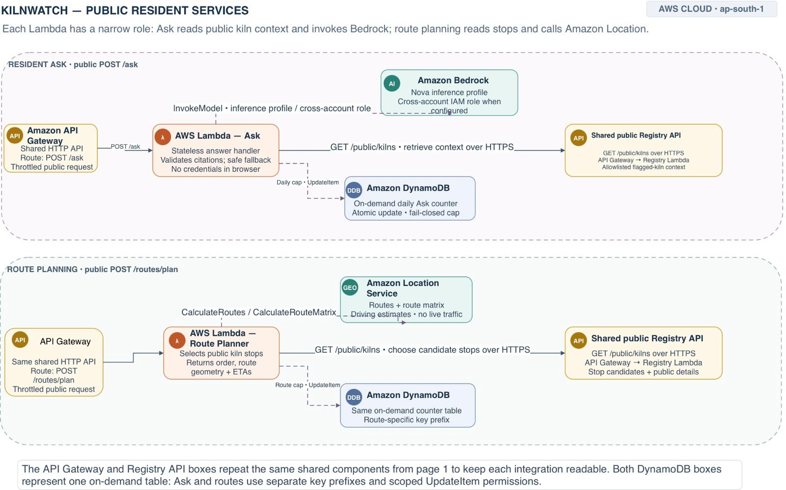

*The assistant's registry and route tools call the shared public API; the route planner also reads public registry data. Neither opens a database connection. Field-photo uploads use presigned S3 URLs issued by the write service.*

| Layer | Why it is there |
| --- | --- |
| **CloudFront + S3** | Serve the portal and published image patches while keeping origin buckets private through Origin Access Control. |
| **API Gateway + Lambda** | Expose narrow contracts, validate requests and apply route-specific throttles. |
| **RDS + PostGIS** | Store kiln footprints, spatial queries, measured assessments, verdicts and resident-request data. |
| **Bedrock** | Select assistant tools and explain returned facts; it does not generate geospatial measurements. |
| **Amazon Location Service** | Supply road travel times and road geometry for bounded inspection routes. |
| **DynamoDB** | Enforce the shared Ask daily cap and retain pending change-review items. |
| **CloudWatch + SNS** | Record operational metrics and logs, with configured error alarms. |
| **Terraform + IAM** | Describe infrastructure and constrain each service's access to its required resources. |

The demo uses public endpoints without sign-in, with input validation, throttles and daily caps. This is a pilot access model; it is not a claim of production staff authentication or enforcement-grade authorization.

### Detection, provenance and publication

The detector runs on **ECS Fargate**, with **Step Functions** controlling each manually started scene execution. **CodeBuild** builds the image and **ECR** stores it. The container verifies the checkpoint hash before loading it and records scene, model, output and image provenance.

**Inference execution: from job to registry**

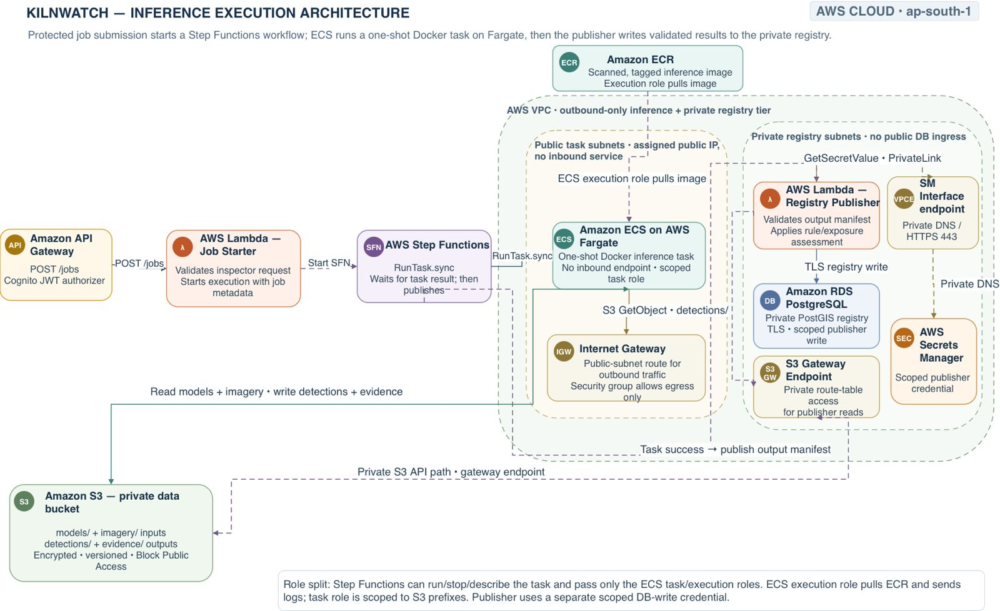

**Evidence delivery and operations**

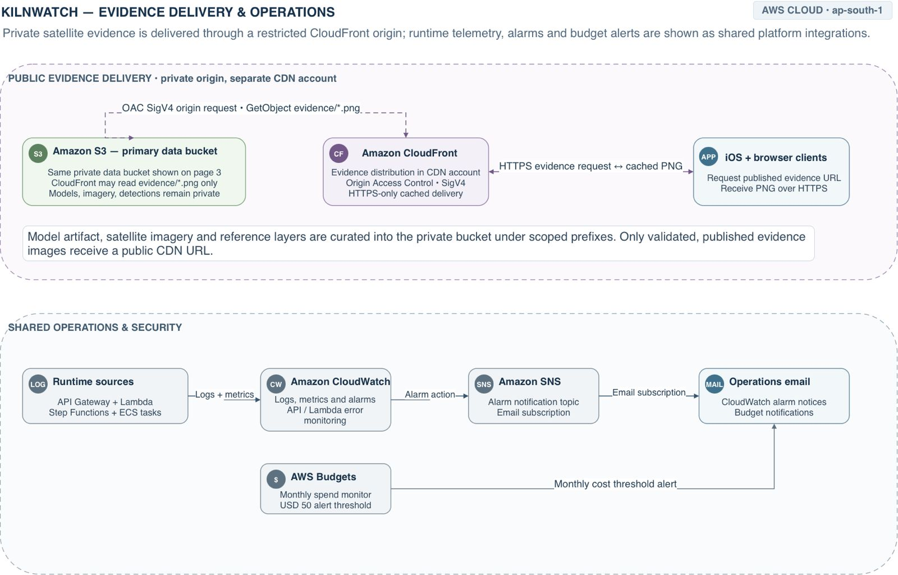

**The boundaries matter:** a detector run writes candidate artifacts, not automatic registry updates. Triage is a separate operator-started process, not yet wired into every scene run. Scheduled ingestion, automatic publication and reviewer approval are future work.

## Three agent roles, with bounded authority

| Role | Implemented behavior | Authority boundary |
| --- | --- | --- |
| **1 · Inspection planner** | Uses registry facts and the deterministic route service to prepare visits and inspection sheets. | Cannot record a verdict or invent an entrance, travel time or measured distance. |
| **2 · Change triage** | Code matches footprints and groups differences; Bedrock writes a reason grounded in the supplied comparison. | Can enqueue a pending review item. Cannot approve it or change kiln status. |
| **3 · Resident assistant** | Answers public-registry questions and returns record citations in the portal. | Uses the same Ask backend as the inspector experience; no verdict-writing tool. |

These are **three product roles**, not three independent conversational runtimes. Inspector planning and resident Ask share the assistant service; triage uses a separate internal invocation path.

Ask validates full kiln IDs and rule IDs against facts returned by tools, checks restricted finding language, and requires route times to be described as estimates. An invalid answer can be regenerated once; otherwise a labelled fallback exposes the records retrieved. These checks constrain answers without claiming to eliminate every possible model error.

Route selection and ordering use **measured registry inputs, a road-duration matrix, nearest-neighbour ordering and 2-opt improvement**. Plans contain at most eight stops and fit a time budget including a 35-minute visit allowance per stop. They are bounded heuristics, not a claim of globally optimal routing; estimated arrivals exclude live traffic, and kiln centroids are not verified entrances.

## The model and what its results mean

**YOLO11s-OBB** predicts rotated kiln footprints and three provisional classes: **FCBK**, **CFCBK** and **Zigzag**. Oriented boxes retain the direction of an elongated kiln rather than forcing every footprint into an axis-aligned rectangle. Training data comes from [SentinelKilnDB](https://github.com/rishabh-mondal/SENTINELKILNDB_NeurIPS_2025).

| Reported baseline metric | Full test | Strict test |
| --- | ---: | ---: |
| mAP at IoU 0.50 | 68.5% | 37.9% |
| mAP at IoU 0.50–0.95 | 43.5% | 24.8% |
| Precision | 67.8% | 68.6% |
| Recall | 67.0% | 42.2% |

*These are the supplied evaluation artifact's results for its named test protocols, not independently measured accuracy on Hapur. The saved training-run identity and a checksum binding those scores to the deployed weights are not established. See [baseline scores](Model/results/baseline_scores.json) and [checkpoint provenance](Model/results/checkpoint-manifest.json). The lower strict-test result remains visible rather than being replaced by the strongest number.*

The deployed checkpoint is hash-pinned. The recorded AWS run returned **39 candidates**, matching the local reference one-to-one at footprint IoU ≥ 0.9, with no class or score differences. That verifies consistency between two runtimes for the same scene; it is **not ground-truth validation**. [Detector run evidence](AWS/docs/local-verification.md#m0-detector-on-aws-38--live-2026-10-11)

## What the evidence can establish

| Information shown | Interpretation |
| --- | --- |
| **Before / after imagery** | Fixed Sentinel-2 snapshots from **5 December 2023** and **5 October 2026**, at **10 m/pixel**, in 256 px patches. They are not a live camera feed. |
| **Predicted kiln type / score** | A model's provisional classification and detector score. Neither establishes site operation or compliance. |
| **Siting flag** | A measured distance compared with a versioned threshold, carrying source and verification context. Applicability and incomplete mapping still require a field check. |
| **People within 800 m** | An HRSL-based estimate around the kiln edge. It is not a measured pollution dose or a health-impact count. |
| **Not detected in an older scene** | A difference between detector outputs. It does not establish a construction date, demolition or closure. |
| **Resident requests** | Anonymous, self-reported concerns. Duplicate browser submissions are suppressed, but clearing storage can bypass that browser-level safeguard. |

The displayed candidate status is **“Flagged by satellite · pending inspection.”** Missing map features, missing assessments and an empty search remain unknown; they are not treated as evidence that an area is safe or a site has passed.

## Evidence for a technical review

The implementation and verification trail are available beside the product code. Passing mocked client tests establish contract handling and interaction behavior; separately documented live checks establish integration. Historical totals below are labelled rather than presented as a fresh all-system run.

| Review question | Evidence |
| --- | --- |
| **Are the API shapes explicit?** | [Shared API contract](App/docs/api-contract.md): registry reads, Ask, routes, verdicts, review queue and inspection requests. |
| **Was the backend and database behavior tested?** | [Request deployment report](AWS/docs/inspection-requests-report.md): 238 backend tests passed with disposable PostGIS; live insert, duplicate and aggregate reads checked. |
| **Do the clients build?** | [Local UI report](App/docs/screens/phase-9/demo-ui-polish-report.md): successful root iOS build, 103 reported core tests with an existing opt-in skip, portal typecheck/build and 96 unit tests. Full browser journeys and iOS video remain incomplete for this latest polish pass. |
| **Was the model executed on AWS?** | [Live verification log](AWS/docs/local-verification.md): CodeBuild, ECR, Fargate scene runs, local/AWS output comparison, Ask checks and triage read-back. |
| **Does the resident-to-inspector loop work live?** | [Inspection request report](AWS/docs/inspection-requests-report.md): hosted portal and iOS count checked at one; test request then cleared. |
| **Where is each responsibility implemented?** | [Model](Model/scripts/), [rules and exposure](AWS/rules/), [assistant](AWS/assistant/), [route solver](AWS/route/), [triage](AWS/triage/), [iOS app](App/KilnWatch/), [resident portal](Web/ResidentPortal/src/). |

### Current limits and next milestones

- **Resolution and ground truth:** 10 m satellite pixels, haze, seasonal appearance and imperfect map layers limit interpretation. Predictions need field verification; the pilot has no independent local accuracy study.
- **Automation:** detector and triage runs are manual. Automatic scene-to-registry updates and reviewer approval are not implemented.
- **Release:** latest UI polish is local; iOS distribution is from Xcode, not TestFlight or the App Store. Independent Hindi review and remaining manual accessibility checks are still open.

## Data and acknowledgements

| Source | Contribution |
| --- | --- |
| [SentinelKilnDB](https://github.com/rishabh-mondal/SENTINELKILNDB_NeurIPS_2025) | Satellite kiln dataset and oriented-footprint benchmark. Its maintainers list **CC BY-NC-SA 4.0**; this prototype credits the dataset authors and preserves the non-commercial/share-alike context. |
| [Sentinel-2 L2A COGs · AWS Open Data](https://registry.opendata.aws/sentinel-2-l2a-cogs/) | Scene imagery accessed through Earth Search; published patches retain Copernicus attribution. |
| [Meta / CIESIN High Resolution Settlement Layer](https://registry.opendata.aws/dataforgood-fb-hrsl/) | Aggregate population estimates, with source attribution attached to the displayed figures. |
| [OpenStreetMap](https://www.openstreetmap.org/copyright) | Portal basemap and mapped features used in geospatial assessment, with attribution and incomplete-coverage limits. |
| [Versioned rule definitions](AWS/rules/rules_v1.json) | Thresholds, source citations, applicability notes and verification levels used by the deterministic engine. |

---

**Evidence first. Inspection next.**

